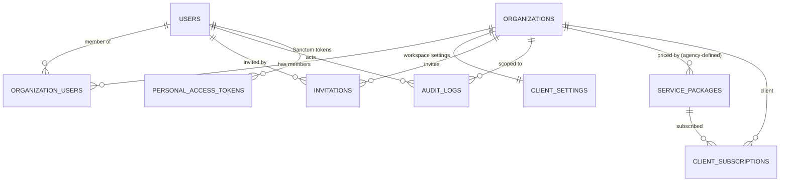

# 02 — Database ER Diagram & Schema

Conventions: BIGINT PKs; `organization_id` FK on every tenant-owned
table with a compound index `(organization_id, …)` on hot query paths;
UTC timestamps; money DECIMAL(15,2) + `currency` CHAR(3) default 'PKR';
soft deletes where recovery matters; provider payloads redacted (§20 of
the prompt).

## Phase 1 ER diagram (implemented now)

Spatie Permission tables (`roles`, `permissions`, `model_has_roles`,
`model_has_permissions`, `role_has_permissions`) are installed by the
package; role assignment for tenant users is anchored to the membership
(`organization_users.role_names` is NOT used — see docs/03 for how
per-organization roles are resolved with Spatie teams feature).

## Phase 1 tables (detail)

### organizations
`id`, `type` ENUM('agency','real_estate_client'), `business_name`,
`legal_name` NULL, `contact_person`, `email`, `phone_e164`,
`country` default 'Pakistan', `city`, `address`, `timezone` default
'Asia/Karachi', `currency` default 'PKR', `logo_path` NULL,
`branding` JSON NULL, `status` ENUM('active','suspended','archived')
default 'active', `account_manager_id` FK→users NULL (agency staff),
timestamps, soft deletes. Index: (type, status).

### users
Laravel default + `phone_e164` NULL, `is_agency_staff` BOOL default
false, `last_login_at` NULL, soft deletes.

### organization_users (memberships)
`id`, `organization_id` FK, `user_id` FK, `status`
ENUM('invited','active','suspended') default 'active', `joined_at`,
timestamps. UNIQUE(organization_id, user_id).

### client_settings (one row per client organization)
`id`, `organization_id` FK UNIQUE, `default_lead_pipeline` JSON,
`approval_rules` JSON, `notification_settings` JSON,
`lead_assignment_mode` ENUM('manual','round_robin','location',
'category') default 'manual', `data_retention_days` NULL, timestamps.

### invitations
`id`, `organization_id` FK, `email`, `role` (string, validated against
role registry), `token_hash` (SHA-256 of the emailed token — never store
the raw token), `invited_by` FK→users, `expires_at`, `accepted_at`
NULL, timestamps. Index: (organization_id, email).

### audit_logs
`id`, `organization_id` FK NULL (null = agency-level/system),
`user_id` FK NULL, `action` (e.g. `organization.created`,
`member.role_changed`, `member.removed`, `invitation.sent`,
`settings.updated`, `export.requested`), `auditable_type`,
`auditable_id`, `metadata` JSON (redacted), `ip_address`, `user_agent`,
`created_at`. Indexes: (organization_id, created_at), (user_id).

### service_packages / client_subscriptions
Packages are defined by the agency org: `id`, `organization_id`
(agency), `name`, `price` DECIMAL, `currency`, `limits` JSON,
`is_active`. Subscriptions: `id`, `organization_id` (client),
`service_package_id`, `status`, `starts_at`, `ends_at`, timestamps.

## Full schema (later phases — table list per prompt §18)

- Social: `social_platforms`, `social_accounts`,
  `social_account_tokens` (encrypted casts only), 
  `social_account_permissions`, `social_webhook_subscriptions`,
  `social_account_logs`
- Publishing: `social_posts`, `social_post_media`,
  `social_post_accounts` (one row per destination: own status, caption
  override, provider post id/URL, attempts, redacted errors),
  `social_post_logs`, `social_post_templates`,
  `social_post_approvals`, `social_post_analytics`
- Leads: `leads` (first-touch source preserved), `lead_sources`,
  `lead_source_events` (every touchpoint), `lead_activities`,
  `lead_assignments`, `lead_followups`, `lead_statuses` (org-configured
  pipeline), `lead_notes`, `lead_consent_records`, `lead_imports`,
  `lead_import_rows`, `lead_custom_field_definitions`,
  `lead_custom_field_values`
- Marketing: `marketing_campaigns`, `campaign_accounts`,
  `campaign_ads`, `campaign_spend` (daily), `campaign_lead_events`,
  `campaign_reports`
- Comms: `conversations`, `conversation_participants`, `messages`,
  `notification_preferences`, `notifications`
- Ops: `media_assets` (org path, mime, size, processing status),
  `webhook_events` (provider, external id UNIQUE per provider+account
  for dedupe), `integration_sync_logs`, `failed_jobs`, `job_batches`

Key constraints for later phases: UNIQUE(provider, external_id) scopes
on social accounts and webhook events; leads matched on normalized
phone/WhatsApp/email with human-review queue for uncertain matches
(prompt §13 — never auto-merge two people on a shared phone alone).
